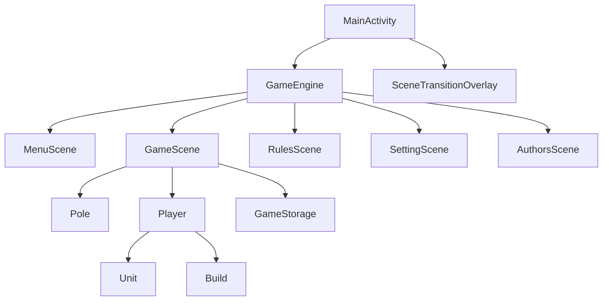

# MyGame

Портретная Android-игра: пошаговая стратегия на шестиугольном поле для двух игроков за одним устройством. Это первая мобильная игра Льва Абасова (2026), написанная на Kotlin.

Игроки по очереди тратят казну на юнитов и здания, ходят по соседним гексам и захватывают клетки. Партия заканчивается, когда клетки остаются только у одного игрока.

Файл [app/README.md](app/README.md) к этому клиенту не относится. Это инструкция по запуску другого проекта — REST-сервера Stim24-LevServerKotlin.

## О проекте

| | |
|---|---|
| Пакет | `com.example.mygame` |
| Модуль | `:app` |
| Версия | 1.0 (`versionCode` 1) |
| minSdk | 24 |
| compileSdk / targetSdk | 36 |
| Kotlin | 2.0.21 |
| Android Gradle Plugin | 8.13.2 |
| UI | Jetpack Compose, Material 3 |
| Ориентация | портрет, полноэкранный режим |
| Язык интерфейса | русский |

Поле рисуется на Compose `Canvas` поверх картинки океана. Отдельного игрового движка (Unity, LibGDX и т.п.) нет: логика хода, касания и отрисовка живут в сценах приложения.

## Как играть

Карта — сетка **11 столбцов на 17 рядов**. Генератор заполняет её сушей (`Terrain.LAND`). Тип `WATER` есть в перечислении и в проверках хода, но на карту вода не ставится: океан виден только как фон.

В партии два человека:

1. Игрок с именем из профиля. Стартовая клетка `(9, 1)`, цвет территории — спрайт `two`.
2. «Игрок 2». Стартовая клетка `(1, 15)`, цвет — спрайт `four`.

Третий игрок в `createPLayers()` закомментирован. Класс `Bot` пустой, компьютер за человека не ходит.

В начале каждому выдаётся скелет на стартовой клетке. Эта клетка и все её соседи становятся территорией игрока. На текущей карте это **7 клеток**.

### Ход

Ходит один игрок. Сверху видны имя, казна и чистый доход (доход минус содержание). Снизу три кнопки: «Здания», «Юниты» и конец хода.

За ход можно:

- открыть магазин и купить здание или юнита на свою клетку, если хватает монет и клетка свободна от своих юнитов и зданий;
- выбрать своего юнита и перейти на соседний доступный гекс (один шаг стоит 1 очко движения, за ход даётся 2);
- нажать конец хода и подтвердить его в окне.

Купленный юнит сразу получает 2 очка движения и может ходить в этот же ход. После успешной покупки магазин закрывается.

Поле можно перетаскивать одним пальцем и масштабировать щипком. Масштаб ограничен: от размера, вписанного в экран, до примерно 10% высоты экрана на гекс.

### Захват и защита

Юнит, встав на клетку, присваивает её своему игроку. Соседние клетки при ходе не захватываются — пачка соседей выдаётся только на старте.

На чужую клетку можно встать, если защита юнита **строго выше** защиты клетки. Защита клетки — максимум защиты своих юнитов и башен, стоящих на ней и на соседних гексах. Паладин эту проверку пропускает и входит на клетку с любой защитой.

Вражеского юнита или здание можно снять, если тип атакующего в перечислении `Terrain` не младше цели. Порядок типов: ферма, башня, усиленная башня, скелет, варвар, рыцарь, паладин. Равный юнит равного уничтожает. Любой юнит, которому защита клетки позволила на неё встать, снимает башню: у всех юнитов порядковый номер выше, чем у башен.

Свои юниты и свои здания занимать нельзя. Свои фермы из клеток хода убираются.

### Конец хода, разорение и победа

Конец хода нужно подтвердить. После подтверждения:

- ход переходит следующему игроку по кругу;
- его юниты снова получают 2 очка движения;
- в казну прибавляется доход и вычитается содержание (`getKazna`); если казна уходит ниже нуля, она становится 0.

Если после этого начисления следующий такой же ход снова ушёл бы в минус, все юниты этого игрока снимаются, экономика пересчитывается, и казна начисляется ещё раз уже без их содержания. Здания при этом остаются.

Победа наступает, когда хотя бы одна клетка есть только у одного игрока. Нейтральные клетки победе не мешают: захватывать всю карту не нужно. Поверх поля показывается карточка победителя и кнопка выхода в меню.

## Баланс

Цифры ниже берёт `GameScene.initEconomic2()`. Именно эта функция вызывается при создании сцены. Рядом лежит `initEconomic()` с другим балансом, она не вызывается.

Доход за ход: **10 монет за свою клетку** и **30 монет за свою ферму**. Юниты и башни монет не приносят. Содержание (`sale`) списывается с казны каждый ход и складывается из содержания юнитов и зданий, кроме ферм.

Стартовая казна в коде — **30**. Доход начисляется в начале хода. При входе в партию начисление сразу получает только первый игрок; второй получает его, когда ход доходит до него. Семь стартовых клеток дают +70, поэтому после первого начисления в казне 100 монет, пока ферм ещё нет.

### Юниты

| Юнит | Код | Цена | Содержание за ход | Защита |
|---|---|---:|---:|---:|
| Скелет | `UNIT1` | 80 | 20 | 1 |
| Варвар | `UNIT2` | 220 | 80 | 2 |
| Рыцарь | `UNIT3` | 600 | 300 | 3 |
| Паладин | `UNIT4` | 1500 | 800 | 4 |

Паладин ходит на клетку с любой защитой.

### Здания

| Здание | Код | Цена | Доход | Содержание за ход | Защита |
|---|---|---:|---:|---:|---:|
| Ферма | `FARM` | 200 + 20×n | +30 | 0 | 0 |
| Башня | `TOWER` | 120 | 0 | 50 | 2 |
| Усиленная башня | `HARD_TOWER` | 350 | 0 | 200 | 3 |

`n` — сколько ферм у текущего игрока уже стоит. База 200 хранится в `Terrain.immutableFARM`. Формула считается в `update_price_farm()`, когда игрок открывает вкладку «Здания».

### Где экран «Правила» расходится с кодом

Слайд «Начало игры» показывает «80 монет», «7 клеток» и «+50 доход». Семь клеток совпадают с раздачей старта. Казна и доход — нет: в коде старт 30, клетка даёт +10, семь клеток дают +70.

Карточки юнитов и зданий на экране правил совпадают с `initEconomic2` (цены, содержание, защита, доход фермы +30, формула цены фермы).

Отдельный побочный эффект кода: `update_price_farm()` при открытии вкладки зданий записывает ферме доход **50**, а не 30. Таблица экономики одна на обоих игроков, поэтому после этого открытия доход каждой фермы в партии становится 50. Экран правил при этом по-прежнему пишет +30.

## Экраны

Переходы между сценами — круглая шторка (iris): сначала круг закрывается, около 80 мс экран полностью чёрный, затем круг открывается. Каждая фаза длится около 670 мс. Пока шторка идёт, касания не принимаются. Повторный переход в ту же сцену и второй переход, пока идёт первый, отбрасываются.

`updateScene` идёт вперёд и запоминает, куда возвращаться. `goBackScene` возвращает назад и не вызывает `onEnter` / `onExit`, поэтому партия при возврате из правил не сбрасывается. Вход в игровую сцену вперёд (`onEnter`) всегда собирает новую карту и новых игроков.

### Меню

Кнопки: новая игра, настройки, правила, авторы. Слева вверху — аватар и имя профиля. Нажатие на аватар открывает поле ввода (не длиннее 10 символов) и сохраняет имя.

Новая игра воспроизводит `start_game` и открывает партию.

### Игра

- Верхняя панель: казна, имя, чистый доход, кнопка паузы.
- Нижняя панель: вкладки магазина и конец хода. Магазин выезжает карточками юнитов или зданий и сдвигает нижнюю границу поля.
- Выбранный юнит показывает имя, оставшиеся очки движения и защиту.
- Под активным юнитом рисуется полоска движения: полная, половина или пустая.
- Недоступные гексы при ходе и при стройке закрываются полупрозрачным шестиугольником.
- Пауза: сохранить, загрузить, вернуться в игру, настройки, правила, в меню. Под кнопками появляется статус сохранения или загрузки.
- Победа: имя победителя, его цвет и выход в меню.

### Правила

Четыре слайда: «Начало игры», «Юниты», «Здания», «Бой и ход». Листаются стрелками. Цифры на слайдах — текст интерфейса; фактический баланс партии описан в разделе «Баланс».

### Настройки

Заглушка: фон меню и кнопка назад. Переключателей звука, сети и игроков нет.

### Авторы

Карточка: фото, «Лев Абасов», «Автор и разработчик», короткий текст и ссылка на профиль Steam. Нажатие на блок ссылки открывает `steamcommunity.com`.

## Архитектура

Одна `MainActivity`. Она держит словарь сцен и `GameEngine` с именем текущей сцены. Касания ловит прозрачный `View` на весь экран и отдаёт их `scene.onTouchEvent` в корутине. Пока идёт переход, слушатель касание проглатывает.



`Scene` — это `update`, `render`, `onTouchEvent`, `onEnter`, `onExit`. `update()` у сцен пустой: перерисовка идёт от `mutableStateOf` и счётчика `forceUpdate`.

Гекс — столбцы со сдвигом. У чётного столбца соседи по диагонали смотрят вверх, у нечётного — вниз. Горизонтальный шаг столбца умножается на `GlobalDxKoef` (0.74), чтобы шестиугольники смыкались.

Цвет территории — индекс в наборе `one.png` … `nine.png`. На клетке подписывается число защиты.

## Структура исходников

Код лежит в [app/src/main/java/com/example/mygame](app/src/main/java/com/example/mygame).

| Путь | За что отвечает |
|---|---|
| [MainActivity.kt](app/src/main/java/com/example/mygame/MainActivity.kt) | Старт, словарь сцен, загрузка профиля, полноэкранный режим, раздача касаний |
| [Scene/](app/src/main/java/com/example/mygame/Scene) | Меню, партия, правила, настройки, авторы |
| [Scene/ForScene/](app/src/main/java/com/example/mygame/Scene/ForScene) | Интерфейс `Scene`, `GameEngine`, фазы iris и оверлей перехода |
| [Scene/GameScene.kt](app/src/main/java/com/example/mygame/Scene/GameScene.kt) | Игроки, экономика, HUD, ход, победа, сохранение партии |
| [Pole/](app/src/main/java/com/example/mygame/Pole) | Сетка клеток, отрисовка гексов, пан и зум |
| [PackagePlayer/Player.kt](app/src/main/java/com/example/mygame/PackagePlayer/Player.kt) | Казна, ход юнита, строительство, бой, подсветка доступных клеток |
| [PackagePlayer/OtherForPlayer/](app/src/main/java/com/example/mygame/PackagePlayer/OtherForPlayer) | `Unit` и `Build` |
| [PackagePlayer/Bot.kt](app/src/main/java/com/example/mygame/PackagePlayer/Bot.kt) | Пустой класс |
| [Economic.kt](app/src/main/java/com/example/mygame/Economic.kt) | Цена, защита, доход, содержание, атака |
| [Terrain.kt](app/src/main/java/com/example/mygame/Terrain.kt) | Типы клеток, зданий и юнитов |
| [GameHudRender.kt](app/src/main/java/com/example/mygame/GameHudRender.kt) | Вёрстка и рисунок панелей партии |
| [GameStorage.kt](app/src/main/java/com/example/mygame/GameStorage.kt) | JSON профиля и партии через Gson |
| [data/](app/src/main/java/com/example/mygame/data) | DTO профиля, игрока, карты и списка игр |
| [PackageForKoor/](app/src/main/java/com/example/mygame/PackageForKoor) | Целочисленные координаты, границы поля, перевод процентов экрана в dp |
| [PictureRender.kt](app/src/main/java/com/example/mygame/PictureRender.kt), [ButtonImage.kt](app/src/main/java/com/example/mygame/ButtonImage.kt) | Картинки, текст и прямоугольные кнопки |
| [SoundPlayer.kt](app/src/main/java/com/example/mygame/SoundPlayer.kt) | Кэш `MediaPlayer` |
| [ClientForServer/](app/src/main/java/com/example/mygame/ClientForServer) | Ktor-клиент, сейчас не вызывается из игры |
| [ui/theme/](app/src/main/java/com/example/mygame/ui/theme) | Шаблонная тема Compose; `MainActivity` её не подключает |

Картинки интерфейса и юнитов — в [app/src/main/res/drawable](app/src/main/res/drawable). Звуки и gif шторки — в [app/src/main/res/raw](app/src/main/res/raw).

Тесты [ExampleUnitTest.kt](app/src/test/java/com/example/mygame/ExampleUnitTest.kt) и [ExampleInstrumentedTest.kt](app/src/androidTest/java/com/example/mygame/ExampleInstrumentedTest.kt) — заготовки Android Studio, игровых проверок в них нет.

## Сохранения

Оба файла лежат во внутреннем каталоге приложения (`context.filesDir`).

| Файл | Содержимое |
|---|---|
| `Profile.json` | Имя и `UUID` игрока. Если файла нет, создаётся профиль «Игрок 1» |
| `game_map1.json` | Один слот партии: экономика, игроки, юниты, здания, номер хода, клетки |

Сохранение и загрузка доступны из паузы. В слоте хранится индекс владельца клетки, защита и тип земли. После загрузки игроки, юниты и здания собираются заново и сажаются на уже существующий объект `Pole`.

## Сеть

В манифесте есть `INTERNET` и `usesCleartextTraffic`. Клиент — Ktor CIO с kotlinx-serialization. Сейчас у него один метод: `POST {base}/myClass` с телом `a1`, `b1` и ответом `sum`.

Базовый адрес собирает `loadServerEndpoint()`: `http://{host}:{port}/v1/game`. Хост и порт берутся из переменных `SERVER_HOST` и `SERVER_PORT`, иначе из classpath-ресурса `server.properties`, иначе это `10.0.2.2` и порт `8080` (так эмулятор видит машину разработчика). Файл [app/src/main/res/server.properties](app/src/main/res/server.properties) лежит в ресурсах Android и этим загрузчиком не читается; в нём указаны `127.0.0.1` и `8080`.

Вызов `myClass` в меню закомментирован. Создание партии, расстановка и конец игры на сервер не уходят. Модели `GameListItem` и `GetGamesResponse` описаны и нигде не используются.

## Что в коде есть, но в партию не входит

- Пустой `Bot`.
- Закомментированный третий игрок.
- Сцена настроек без параметров.
- Неиспользуемый баланс `initEconomic()`.
- Сетевой клиент и DTO списка игр.
- Тема `MyGameTheme`.

## Сборка и запуск

Нужны Android Studio, JDK, совместимый с AGP 8.13, и SDK с платформой 36. Открыть корень репозитория и запустить конфигурацию `app` на устройстве или эмуляторе.

Из консоли, из корня репозитория:

```bat
gradlew.bat :app:assembleDebug
```

На macOS и Linux:

```bash
./gradlew :app:assembleDebug
```

Зависимости модуля: Compose BOM `2024.09.00`, Material 3, Gson 2.10.1, Jackson Kotlin 2.15.2, kotlinx-serialization-json 1.6.0, Ktor Client 2.3.12 (core, CIO, content negotiation, JSON), Coil 2.7.0 и Coil GIF. Игровой цикл сохраняет JSON через Gson. Ktor и kotlinx-serialization нужны клиенту. Coil в сценах не используется: картинки грузятся через `ImageBitmap`, `painterResource` и `BitmapFactory`.

## Звук

`SoundPlayer` заранее создаёт `MediaPlayer` и при новом звуке отпускает уже закончившиеся.

| Файл | Когда играет |
|---|---|
| [button.mp3](app/src/main/res/raw/button.mp3) | Кнопки меню, магазина, правил, паузы |
| [start_game.mp3](app/src/main/res/raw/start_game.mp3) | «Новая игра» |
| [hod.mp3](app/src/main/res/raw/hod.mp3) | Подтверждение конца хода |
| [victory.mp3](app/src/main/res/raw/victory.mp3) | Появление карточки победы, один раз за показ |
